  <a href="https://www.whatsthisposition.com"><b>Review a game</b></a>&emsp;
  <a href="https://chromewebstore.google.com/detail/bngblpcelnjnhbmaljgelkddkfhjneka">Chrome extension for Chess.com</a>&emsp;
  <a href="https://github.com/acunli/whatsthisposition">Source, GPL-3.0</a>

  
  

  
  
  
  

The plain-text version

I'm a first-year Business AI Systems student at NUS Computing in Singapore, working towards AI/ML engineering. I like the part of AI where models stop being demos and start being systems: pipelines that take messy real-world input, reason over it, and ship something useful.

- **[whatsthisposition](https://www.whatsthisposition.com)**: free, open-source chess game review. Stockfish 19 runs in your browser, labels every move from Brilliant to Blunder and explains why. Solo build, with a Chrome extension for Chess.com.
- **[ClipContext](https://github.com/acunli/ClipContext)**: multimodal video understanding that writes titles, descriptions and hashtags from what a clip says and shows, ranked by a second model. Team lead; world #8 of 20,000 at the lablab.ai AMD Developer Hackathon ACT II.
- **[WattLah!](https://github.com/acunli/LifeHack2026)**: gamified home energy audits in a pixel-art flat. LifeHack 2026.
- **NES Finance Tool**: finance governance for the NUS Entrepreneurship Society, where I'm Technical Executive. Private repo.
- **Chakr**: refurbished bicycles for students who needed them. I ran its finances and web app; 260+ bikes, SGD 3,300+ raised, tGELF Youth Leader 2024–25 winner.

Every image here is drawn by <a href="gen/">gen/</a> with no dependencies and redrawn daily by a GitHub Action. The chess labels and explanations come from whatsthisposition's own engine. Fonts: Anton, Space Grotesk, JetBrains Mono and Archivo (SIL OFL 1.1). Chess pieces: mpchess by Maxime Chupin (GPL-3.0+).
